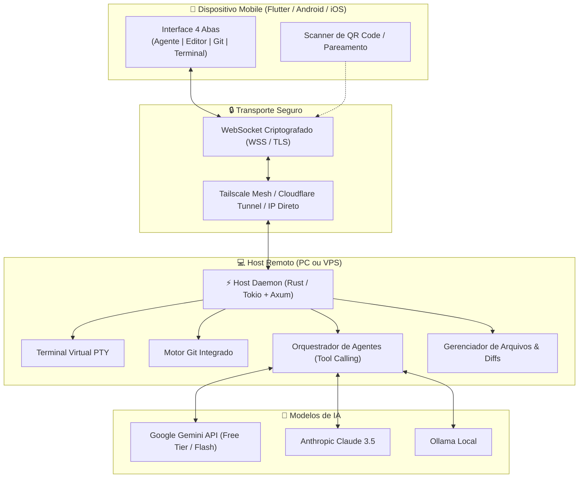

# 🛰️ Antigravity Mobile Orbit (by CESIC)

<div align="center">

[](https://opensource.org/licenses/MIT)
[](https://www.rust-lang.org/)
[](https://flutter.dev/)
[](https://deepmind.google/technologies/gemini/)
[](CONTRIBUTING.md)

**A solução definitiva para programar, orquestrar agentes autônomos de IA e controlar a IDE Antigravity direto do seu smartphone.**

[Visão Geral](#-visão-geral) •
[Arquitetura](#-arquitetura) •
[Recursos](#-principais-recursos) •
[Estrutura](#-estrutura-do-monorepo) •
[Início Rápido](#-início-rápido) •
[CESIC](#-sobre-a-cesic)

</div>

---

## 🌟 Visão Geral

O **Antigravity Mobile Orbit** permite que você programe e comande agentes de IA (Google Gemini, Anthropic Claude, Ollama) no seu PC ou VPS sem precisar estar na frente do computador. 

Chega de ficar preso à mesa: dispare tarefas de refatoração, criação de telas ou correção de bugs pelo celular, aprove alterações com visualizador de diffs e receba notificações push quando o trabalho estiver pronto.

### Por que esta arquitetura?
- **📱 Leve no Celular:** Interface nativa e fluida a 60/120 fps construída em **Flutter**. Sem drenagem de bateria nem aquecimento.
- **⚡ Poder Bruto no Host:** O **Host Daemon em Rust** consome menos de 25 MB de RAM no seu computador ou em uma VPS de \$3-\$5/mês, executando tarefas pesadas em segundo plano.
- **🆓 100% Gratuito (BYOK):** Funciona com o nível gratuito da API do **Google Gemini (Google AI Studio)** e com modelos locais via **Ollama**. Custo \$0 para quem usa e \$0 de servidores para a comunidade.

---

## 🏗️ Arquitetura



---

## 🚀 Principais Recursos

1. **🤖 Espaço de Trabalho do Agente:** Converse com a IA em tempo real com streaming de raciocínio, inspeção passo a passo de ferramentas e aprovação visual de diffs com 1 toque.
2. **📝 Editor de Código Otimizado para Toque:** Realce de sintaxe colorido, árvore de pastas completa e barra de atalhos touch com caracteres essenciais (`{`, `}`, `;`, `tab`, `//`).
3. **🌿 Painel Visual do Git:** Visualize arquivos modificados (*staged* / *unstaged*), alterne branches, gere mensagens de commit inteligentes via IA e faça Push/Pull para o GitHub.
4. **💻 Terminal Interativo PTY:** Terminal completo colorido para inspecionar logs ou rodar comandos (`npm`, `cargo`, `docker`, etc.) diretamente da VPS/PC.
5. **📷 Pareamento Instantâneo por QR Code:** Inicie o daemon no computador e aponte a câmera do celular para conectar automaticamente, sem necessidade de digitar tokens ou IPs complexos.
6. **🔔 Execução em Segundo Plano & Notificações:** Envie uma tarefa pesada, bloqueie o celular e receba uma notificação push quando o agente terminar de programar e os testes passarem.

---

## 📁 Estrutura do Monorepo

```text
antigravity-mobile-orbit/
├── .github/workflows/          # CI/CD para compilação automática
├── daemon/                     # Host Daemon em Rust (Axum + Tokio)
│   ├── Cargo.toml
│   └── src/
│       ├── main.rs             # Ponto de entrada e QR Code terminal
│       ├── server/             # WebSocket Hub & rotas HTTP
│       ├── agent/              # Loop de execução autônoma de ferramentas
│       ├── providers/          # Gemini, Claude e Ollama
│       ├── git/                # Gerenciador Git local
│       └── terminal/           # Emulador PTY
├── mobile/                     # Aplicativo Mobile em Flutter
│   ├── pubspec.yaml
│   └── lib/
│       ├── main.dart
│       ├── core/               # Conectividade e armazenamento seguro
│       └── features/           # Agente, Editor, Git e Terminal
└── docs/                       # Guias e diagramas arquiteturais
```

---

## ⚡ Início Rápido

### 1. Executando o Host Daemon (no PC ou VPS)
```bash
cd daemon
cargo run --release
```
O daemon exibirá um **QR Code** no terminal contendo a chave de conexão segura temporária.

### 2. Executando o Aplicativo Mobile
```bash
cd mobile
flutter run
```
No celular, abra o app, toque em **"Conectar Novo Host"** e aponte a câmera para o QR Code gerado no terminal. Pronto! Você já está no controle.

---

## 🌐 Onde Hospedar 100% de Graça (Free Tier Guide)

Se você quer deixar o **Antigravity Daemon** rodando 24 horas por dia em segundo plano sem gastar R$ 1,00 e sem depender de deixar o PC ligado, aqui estão as melhores opções gratuitas do mercado:

### 1. 👑 Oracle Cloud Infrastructure (OCI) — O Rei das VPS Gratuitas
A Oracle oferece o melhor programa **Always Free** do mundo:
- **4 OCPU ARM Ampere + 24 GB de RAM** (Gratuito para sempre! Você pode criar 1 máquina potente com 24GB ou até 4 instâncias menores).
- **2 instâncias AMD x86** (1 GB de RAM cada, também grátis para sempre).
- **200 GB de armazenamento** em disco e IP público IPv4 gratuito.
- **Como usar:** Crie uma conta no Oracle Cloud Free Tier, suba uma VM Ubuntu 22.04/24.04 ARM ou x86, instale o daemon compilado e deixe rodando 24/7!

### 2. 🛡️ Cloudflare Tunnels (Zero Trust) — Acesso Remoto Grátis sem Abrir Portas
A Cloudflare não fornece uma VPS tradicional para rodar processos longos de terminal, mas oferece o **Cloudflare Tunnel (cloudflared)** que é **100% gratuito**:
- Permite expor o seu PC de casa ou qualquer VPS para a internet com conexão criptografada HTTPS/WSS (ex: `orbit.seusite.com`).
- **Sem abrir portas no roteador (sem Port Forwarding / NAT)** e sem risco de expor seu IP real.
- Proteção DDoS nativa da Cloudflare.

### 3. ☁️ Google Cloud Platform (GCP) — Instância e2-micro Grátis
- O Google Cloud oferece **1 VM e2-micro gratuita para sempre** (2 vCPUs compartilhadas, 1 GB de RAM, 30 GB de disco) nas regiões dos EUA (`us-central1`, `us-east1`, `us-west1`).
- Ideal para rodar o `agy-daemon` em Rust, já que o nosso binário consome menos de 25 MB de RAM!

### 4. 🔗 Tailscale — VPN P2P Segura (Até 100 dispositivos grátis)
- Se você prefere deixar o daemon rodando no seu computador pessoal de casa, instale o **Tailscale** no PC e no celular.
- Conexão direta e criptografada (WireGuard) em qualquer lugar do mundo (4G, 5G ou Wi-Fi de hotel) sem precisar configurar DNS dinâmico nem mexer no roteador.

---

## 🛡️ Segurança

- Conexão criptografada de ponta a ponta.
- Autenticação por token criptográfico de alta entropia gerado a cada sessão.
- Compatibilidade nativa com redes privadas seguras (**Tailscale**) para acesso remoto sem abrir portas no roteador de casa.

---

## 🏢 Sobre a CESIC

Projeto idealizado e mantido com orgulho pela **CESIC** para fomentar o ecossistema brasileiro e global de desenvolvimento de software acelerado por Inteligência Artificial.

Distribuído sob a licença [MIT](LICENSE).

