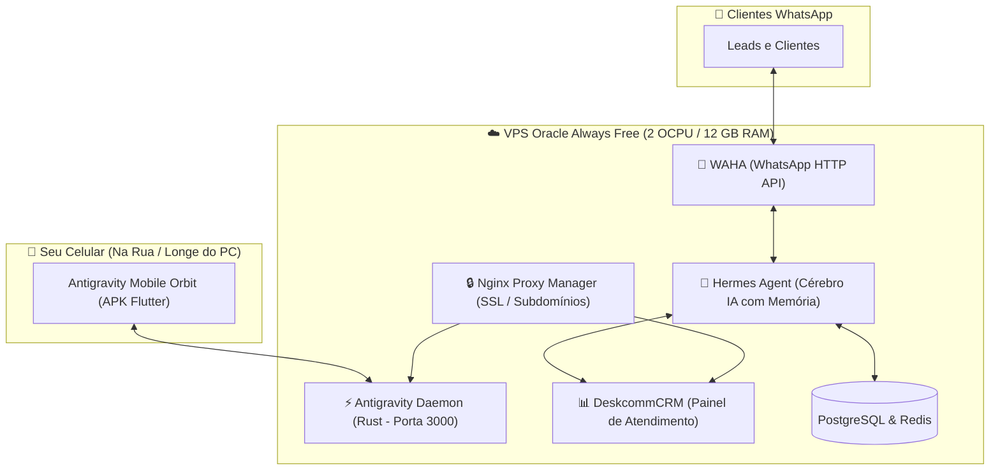

# 🛰️ Antigravity Mobile Orbit & Mini-Datacenter CESIC
## 📋 Guia Mestre e Checklist Completo para Amanhã

> **Status Atual:** 🟢 **Tudo Salvo & Compilado no GitHub!**  
> Repositório: `https://github.com/alisonmelo/ide-antigravity-mobile`  
> - **APK Android:** Compilado e pronto para download (`app-release-apk`).  
> - **Daemon Linux (VPS):** Compilado e pronto para download (`daemon-ubuntu-latest`).  
> - **Daemon Windows (PC):** Compilado e pronto para download (`daemon-windows-latest`).

---

## 🎯 Visão do Ecossistema CESIC na VPS Oracle



---

## ☕ Checklist de Amanhã (Passo a Passo Descomplicado)

Quando você acordar, descansado e com um café do lado, basta seguir esta ordem:

### 1️⃣ Criar a Conta na Oracle Cloud (10 minutos)
- [ ] Acessar: **[oracle.com/cloud/free](https://www.oracle.com/cloud/free/)**
- [ ] **Home Region:** Escolha **US East (Ashburn)** para ter disponibilidade imediata de máquina ARM sem filas de capacidade.
- [ ] **Nome e Endereço:** Coloque exatamente igual ao do seu cartão de crédito (inclusive abreviações).
- [ ] **Cartão Virtual:** Use cartão virtual com compras internacionais ativadas e R$ 10 a R$ 15 de limite liberado (a Oracle cobra R$ 5-7 e estorna na hora).

### 2️⃣ Criar a Máquina Virtual (VPS)
- [ ] No painel da Oracle, clique em **"Criar uma instância de VM"**.
- [ ] **Imagem:** Canonical Ubuntu 24.04 ou 22.04 Minimal.
- [ ] **Forma (Shape):** Ampere ARM (`VM.Standard.A1.Flex`).
- [ ] **Configuração Segura (Nova Cota):** **2 OCPUs e 12 GB de RAM** (grátis para sempre, 24/7 o mês todo!).
- [ ] **Disco:** 50 GB a 100 GB.
- [ ] **Chave SSH:** Clique em **"Save Private Key"** e salve o arquivo `.key` no seu PC.
- [ ] Clique em **Criar** e anote o IP Público quando ficar verde (*Running*).

### 3️⃣ Liberar o Firewall (2 minutos)
- [ ] No painel da Oracle: *VCN ➔ Security Lists ➔ Default Security List ➔ Add Ingress Rule*.
  - Origem: `0.0.0.0/0`
  - Porta: `3000` (e portas `80` e `443` para sites/CRM).
- [ ] Conectar via PowerShell:
  ```powershell
  ssh -i "caminho\sua_chave.key" ubuntu@SEU_IP_PUBLICO
  ```
- [ ] Liberar o firewall do Ubuntu:
  ```bash
  sudo iptables -I INPUT 6 -m state --state NEW -p tcp --dport 3000 -j ACCEPT
  sudo netfilter-persistent save
  ```

### 4️⃣ Subir o Antigravity Daemon na VPS
- [ ] Baixar o binário `agy-daemon` compilado pelo GitHub Actions:
  ```bash
  # Na VPS:
  chmod +x agy-daemon
  export GEMINI_API_KEY="sua_chave_do_google_ai_studio"
  ./agy-daemon
  ```
- [ ] O daemon vai imprimir o **QR Code** no terminal da VPS!

### 5️⃣ Instalar o App no Celular e Testar
- [ ] Baixar o `app-release-apk` do GitHub Actions no celular.
- [ ] Instalar o APK no Android.
- [ ] Conectar no IP da VPS com o token.
- [ ] Fazer o primeiro teste mandando o agente programar do celular!

### 6️⃣ Próxima Etapa: Subir o DeskcommCRM + Hermes Agent
- [ ] Instalar o Docker na VPS (`curl -fsSL https://get.docker.com | sh`).
- [ ] Subir o DeskcommCRM com WAHA para automatizar o WhatsApp com o Hermes Agent da Nous Research.

---

> 💤 **Agora vá dormir e descansar!** Todo o código, workflows, compilações e planos estão 100% seguros no GitHub e no seu disco local. Amanhã a gente continua voando!
